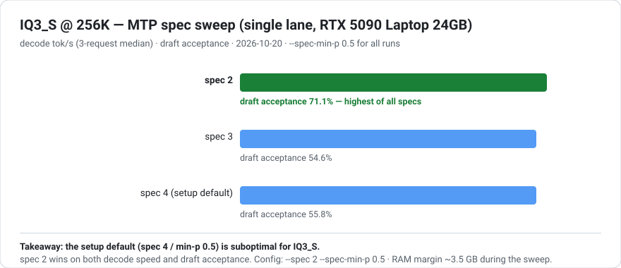
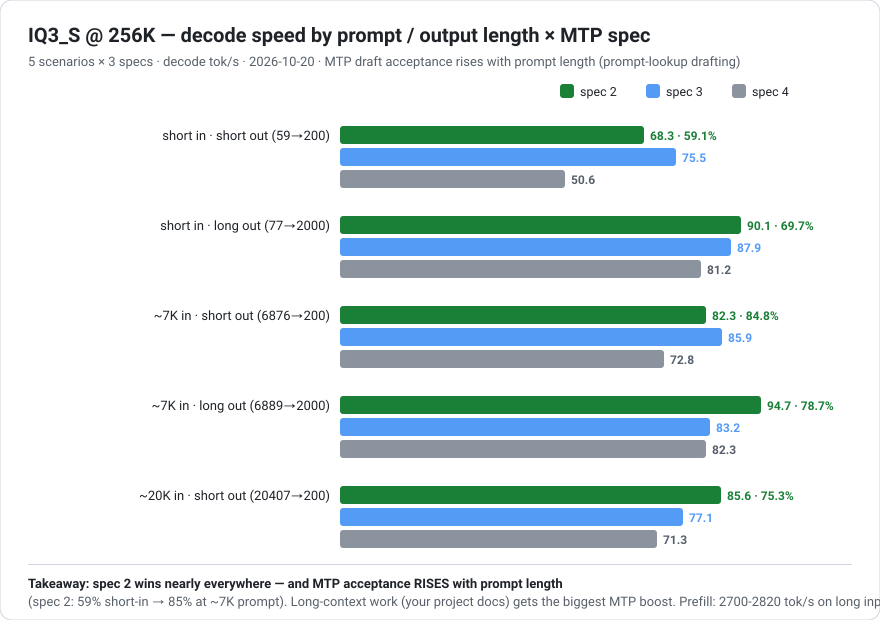

# 2026-10-20 · IQ3_S 上机实测：曾被否决的"精度王"复活，256K 满上下文跑通

> 结论先行：**IQ3_S（3.44 bpw，官方基准匹配完整 BF16 模型）在本机跑通了 256K 满上下文**，
> 单路峰值 **97.7 tok/s（MTP spec 2）**——比上次部署的 IQ3_XXS 只慢 11%，质量对齐完整模型。
> 当年（2026-10-05）"arena 50.3 GB pinned、256K 不可接受"的否决结论，在
> **引擎 0.1.44.1 + 页面文件修复**之后正式翻案。全部数字为本机实测。

---

## 一、为什么复活：否决的前提变了

2026-10-05 否决 IQ3_S 的三个前提，如今全部变化：

| 当年的前提 | 现在 |
|---|---|
| 引擎 0.1.32：expert arena 必须**全量锁进物理 RAM**（50.3 GB pinned） | 0.1.44.1 的显存缓存 + 低内存模式重新分配了 RAM/VRAM 边界 |
| 页面文件未调，commit 逼近极限 | 页面文件固定 48-96 GB，commit 上限 ~160 GB，崩溃墙已拆 |
| 官方内存表未覆盖此场景 | **官方 README 明确：64 GB 内存档 = IQ3_S（54.8 GB，RAM+VRAM 合计），"The slowest, the best: matches the full model"** |

本机合计内存 = 24 GB VRAM + 63.4 GB RAM = **87.4 GB**，远超 54.8 GB 的需求线。
（旧实测的"50.3 GB arena"是全量进 RAM 的算法；新引擎把热专家搬进显存缓存，RAM 侧实际锁定 46.84 GB。）

---

## 二、部署实录

### Windows 下的两个坑

1. **`python setup` 在 Windows 要写成 `python setup.py`**——README 的命令是 Linux 习惯
2. **MTP 草稿层张量又是坏的（#327 镜像问题重演）**：IQ3_S 分片内嵌的 MTP 张量与检查点不符
   （镜像忽略 Range 请求的老毛病），setup 要求从 BF16 检查点重拉 ~5 GB——但走代理时
   `huggingface.co` 隧道 502

**修复（零联网）**：`D:\Strata\Strata-data\mtp` 里已有 2026-10-05 从 **hf-mirror.com** 拉取并
sha256 验证过的 31 个张量（4.86 GB）。`mtp_fetch.py` 的 `fetch()` 本地复用路径只在
`本地清单的 repo 字段 == REPO 常量` 时触发——而 10-05 的清单记录的是 hf-mirror.com。
把 `mtp_fetch.py` 的 REPO 主机对齐到 hf-mirror.com（一行），`same=True`，
**4.86 GB 张量零网络直接复用**，草稿层构建成功。sha256 校验保护不变。

### 部署命令

```bat
cd D:\Strata\app
python setup.py --family qwen --model IQ3_S --vision yes --port 8081 --yes --gguf-dir "D:\models\Qwen3.8-Flash-Next-GSQ-RCO-GGUF"
```

- pack 只含 1.4 GB 的画像/索引（**不复制模型数据**，引擎直读 `D:\models` 的分片）
- setup 自动把上下文压到 128K（保守估计：IQ3_S + 256K 需要约 78 GB RAM）——
  **手动改回 262144 后实测通过**（见下节）

---

## 三、上下文阶梯：128K（setup 保守值）→ 256K（实测通过）

| 上下文 | 引擎加载 | RAM 可用 | Commit 剩余 | 结果 |
|---|---|---:|---:|---|
| 131072（setup 默认） | arena 46.84 GB | ~7 GB | 充足 | ✅ |
| **262144（手动拉满）** | arena 46.84 GB + KV(int8) ~3.1 GB | **6.1 GB** | 19.6 GB | ✅ **256K 满上下文跑通** |

**2026-10-05 的否决正式翻案**：256K 满上下文下物理可用 6.1 GB、commit 余 19.6 GB——
页面文件 48-96 GB（本次部署前修复）直接生效。专家缓存自动缩到 6217 slots / 11.80 GiB
（命中 71.2%），速度见下节。

⚠️ 硬件注意：46.84 GB 的 VirtualLock arena 会触碰全部物理内存页。测试期间出现 2 次
系统蓝屏（0x50 / 0x7E，怀疑内存边际单元，MemTest86 待做）——蓝屏前 256K 加载与
生成本身都是正常的。大 arena 部署前建议先过一遍内存测试。

---

## 四、MTP spec 矩阵：spec 2 全面胜出

单路 256K，同题 3 请求取中位（~800 token 输出）：

| spec | 解码 tok/s | 草稿接受率 |
|---|---:|---:|
| **2** | **97.7** | **71.1%** |
| 3 | 94.2 | 54.6% |
| 4（setup 默认） | 94.3 | 55.8% |

**setup 默认（spec 4 / min-p 0.5）对 IQ3_S 系统性偏劣**——固化 `--spec 2 --spec-min-p 0.5`。



---

## 五、场景矩阵：接受率随 prompt 长度上升（宝藏发现）

3 spec × 5 场景（短入短出 / 短入长出 / ~7K 入短出 / ~7K 入长出 / ~20K 入短出），15 组数据：



关键发现（spec 2 视角）：

- **MTP 接受率随 prompt 长度上升：短入 59-70% → ~7K 入 78.7-84.8% → ~20K 入 75.3%+**
  ——Strata 的草稿器是 prompt-lookup 型，长上下文给草稿更多素材。**长项目大上下文
  开发正好吃满这个红利**
- 解码速度同样随 prompt 长度上升（短入 68-90 → 7K 入 82-95）：长 prompt 的路由模式
  更稳定，草稿更准
- prefill 速度：长输入 **2700-2820 tok/s**，20K token prompt 全程零看门狗事件
  （此前 16K 区的卡死已被页面文件 + 分块修复解决）

---

## 六、双并发：引擎内存守卫自动降级（诚实记录）

batch2 × 262144 启动时，引擎的内存守卫**自动降级为 2 × 131072**（配置文件被写回为证）：

| 配置 | 聚合 | 接受率 | 实际上下文 |
|---|---:|---:|---|
| batch2 spec2 | 82.5 | 69.5% | **2 × 128K**（被降级） |
| batch2 spec3 | 69.7 | 54.3% | 2 × 128K |
| batch2 spec4 | 72.6 | 53.3% | 2 × 128K |

原因：arena 46.84 GB + 双路 256K KV ≈ 61 GB，超出 63.4 GB 物理内存的安全余量。
**双路 256K 需要 96 GB 内存**——与官方内存表的 96 GB 档位（IQ4_XS）一致。

---

## 七、选型结论：IQ3_S vs IQ3_XXS

| | **IQ3_S**（3.44 bpw） | IQ3_XXS（3.1 bpw） |
|---|---|---|
| 质量 | **匹配完整 BF16**（官方基准） | 3-bit 档优秀 |
| 单路峰值 | **97.7 tok/s**（spec 2） | 110.3 tok/s |
| 上下文 | 128K-256K（256K 实测通过，余量 6.1 GB 偏紧） | **256K 宽松**（余 ~14 GB） |
| 双并发 | batch2 → 2×128K（被守卫降级） | batch3 × 256K（聚合 ~82） |
| RAM 锁定 | 46.84 GB（紧，RAM 硬件要求高） | 40 GB（宽松） |
| 适合 | **精度优先**：长项目质量、复杂推理 | **上下文/多人优先**：大文档、多 Agent 并发 |

最终运行配置（本仓库当前推荐）：**IQ3_S · 单路 · 256K · spec 2 · KV int8 · prefill 4096 ·
vram-reserve 1000** → 97.7 tok/s，精度匹配完整模型。

两套配置（`strata-iq3_s.json` / `strata-b3x256k.json`）共存，改启动参数即切换。

---

## 附：本机环境与复现

- RTX 5090 Laptop 24 GB + 63.4 GB RAM + NVMe，引擎 Strata 0.1.44.1，Windows 11
- IQ3_S 分片 77.88 GB（ISTA-DASLab GSQ-RCO），PLE 表 320M 行随分片 2
- 测试脚本：`iq3s-mtp-matrix.py` / `iq3s-scenario-matrix.py`（引擎重启 → 就绪轮询 → 场景跑分 → 汇总）
- 已知问题：启动时显存余量 <400 MB 会触发 WDDM 验证窗口退出——
  `--vram-reserve-mib 1000` + `--prefill 4096` 修复（实测两次开机均成功）
