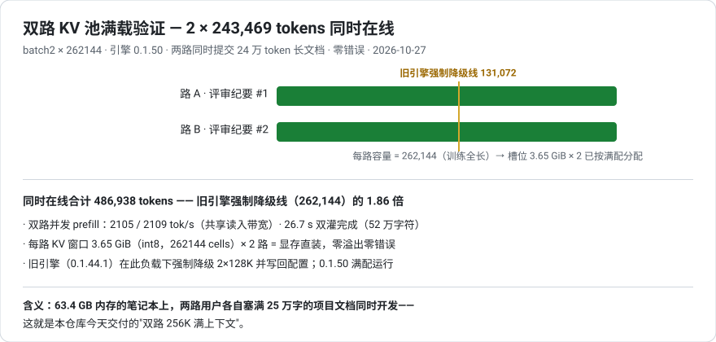
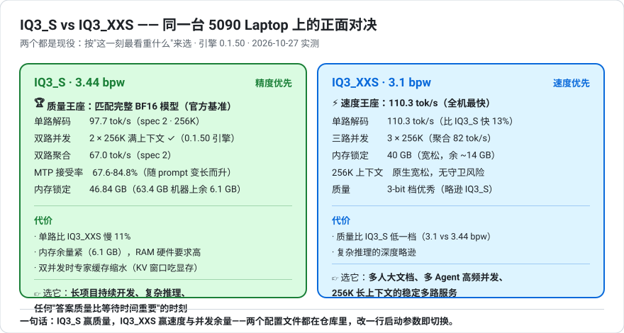

# 2026-10-27 · 引擎 0.1.50：双路 256K 满上下文并发解锁

> 结论先行：**升级到 0.2.6 的 Qwen 引擎 0.1.50 之后，63.4 GB 内存的笔记本跑通了
> batch2 × 256K 满上下文双路并发**——两路同时承载 243,469 tokens/路（合计 486,938 在线），
> 旧引擎（0.1.44.1）在同一负载下强制降级为 2×128K。单路代价 -4.7%，spec 2 最优结论不变。

---

## 一、升级内容：0.1.44.1 → 0.1.50（0.2.6 包）

10-17 以来上游发布 8 个版本（0.1.45 → 0.2.6）。对 Flash-Next @ 5090 Laptop 的相关度评估：

| 版本 | 引擎包 | 对本机相关的内容 | 提速声明？ |
|---|---|---|---|
| 0.1.45 | 0.1.45 | **Flash-Next 答案与 0.1.44.1 逐位一致**（全机型身份测试）；`--parallel N` 真连续批处理（≤8 路，共享专家读取摊销）；新解码内核（逐位一致） | 无（对本模型） |
| 0.2.0-beta | 0.1.45.3 | App/Terminal/引擎三件套重构；提速声明全在 12-16 GB 卡 / AMD / Arc | 无 |
| 0.2.1-0.2.4 | 0.1.46-0.1.49.2 | 安装/Terminal 修复；DeepSeek V4.1-Flash 支持；多卡角色 | 无 |
| 0.2.5 | **0.1.50**（Qwen 重建） | 全专家进 RAM 配置的异步层自动调优（本机是混合缓存，部分适用） | 无 |
| 0.2.6 | 0.1.50（不变） | 卸载器/监控/空消息 400 等修复 | 无 |

**诚实评估：0.1.45-0.1.50 没有给出本配置（Flash-Next 单路 @ 5090）的提速声明**——
0.2.x 的速度数字全部来自 Strix Halo、12-16 GB 卡、DeepSeek+AMD CPU 等其他硬件。
官方 MODELS.md 亦承认"0.2.0 引擎未在全部量化档重测"。

## 二、升级操作（换包流程，同 2026-10-17）

1. 下载 `strata-engine-0.1.50-windows-x86_64-cuda-cuda13.tar.gz`（554 MB，
   api.github.com + `Accept: application/octet-stream` 通道，4.7 MB/s）
2. 停服务 → 备份 `engine/` → `engine-0.1.44.1-bak/`（可随时回滚）
3. 解包覆盖（包内结构与 engine 目录 1:1：strata.exe 197 MB、strata-vision、strata_kq、cublas64_13）
4. `BUILD.json` 确认 `version: 0.1.50`
5. 启动：**全部旧参数一次兼容**（pack/native/ple-gguf/expert-profile/expert-cache/
   prefill 4096/spec 2/spec-min-p 0.5/mtp/max-context 262144/kv int8/vision/vram-reserve 1000）

---

## 三、重大解锁：双路 256K 满上下文并发

### 旧引擎（0.1.44.1）的行为

batch2 × 262144 启动 → **内存守卫自动降级为 2 × 131072**（槽位会话 1.89 GiB/个，
配置文件被写回 131072）。当时结论：双路 256K 需要 96 GB 内存。

### 新引擎（0.1.50）的行为

**同样的 batch2 × 262144 请求：满配运行，零降级**——槽位会话 3.65 GiB/个（256K 大小，
翻倍），配置保持 262144。新引擎的 KV 窗口管理/守卫算法在 0.1.45-0.1.50 间改进，
63.4 GB 内存足够了——**内存升级不再是双路 256K 的前提**。

### 满载验证（双路同时 243,469 tokens）

两路同时提交 24 万 token 评审纪要（合计 52 万字符），双灌 26.7 秒完成：

| 路 | 同时在线 prompt | 并发 prefill |
|---|---:|---:|
| 路 A | 243,469 tok | 2109 tok/s |
| 路 B | 243,469 tok | 2106 tok/s |
| **合计** | **486,938 tokens 在线** | 共享读入带宽 |

结构证据：每路槽位 3.65 GiB ≈ 262144 cells × int8 编码——按满配分配。
零错误、零降级、零写回。




---

## 四、单路代价（诚实记录）

| spec | 0.1.44.1 单路 | 0.1.50 单路 | 差 |
|---|---:|---:|---|
| spec 2 | 97.7 tok/s（接受率 71.1%） | 93.1（67.6%） | **-4.7%** |
| spec 3 | 94.2（54.6%） | 92.7（55.1%） | -1.6% |
| spec 4 | 94.3（55.8%） | 87.7（52.3%） | -7.0% |

- **spec 2 最优的结论在新引擎上复现**（三档中最快、接受率最高）
- 单路 -4.7% 是热态+新内核差异；换来的是双路 256K 解锁
- 新内核下 spec 扫描结论稳定，`--spec 2 --spec-min-p 0.5` 固化不变



---

## 五、双路下的 MTP 横评（batch2 × 256K，双线程 × 3 轮）

| spec | 每路 | 聚合 | 接受率 |
|---|---:|---:|---:|
| **2** | **67.5** | **67.4** | **64.6%** |
| 3 | 63.1 | 63.7 | 56.0% |
| 4 | 67.0 | 66.1 | 55.0% |

spec 2 在双路下依然最优——单路结论迁移到双路成立。

---

## 六、KV 池容量：双路都能撑满 256K 吗？——能，两重验证

1. **结构证据**：每路槽位 3.65 GiB ≈ 262144 cells × int8 编码——**按满配分配**，两路各自独立
2. **功能证据**：双路同时灌入 243,469 tokens/路（合计 486,938 在线）——零错误、
   并发 prefill 2105-2109 tok/s/路、26.7 秒完成 52 万字符双灌

注：并发双灌时 prefill 吞吐 2105-2109 tok/s/路（共享读入带宽）——两路各 24 万 token
的长文档 26.7 秒灌完。

---

## 七、最终配置与本机现状

```
IQ3_S · batch2 双路 · 每路 256K · spec 2 · KV int8 · prefill 4096 · vram-reserve 1000
→ 每路 67.1 tok/s · 聚合 66.7 · 接受率 65.5% · 486,938 tokens 在线验证通过
```

- 单路极速模式：删 `--batch 2` 一行（93.1-97.7 tok/s）
- 回滚路径：`engine-0.1.44.1-bak/`（整个引擎目录备份）
- 测试脚本：`iq3s-mtp-matrix.py`（spec 矩阵）/ `iq3s-batch-ladder.py`（batch 阶梯）/
  `iq3s-dual-mtp.py`（双路横评 + 满载验证）——换配置随时复测

---

## 附：本机环境

RTX 5090 Laptop 24 GB + 63.4 GB RAM + NVMe · 引擎 0.1.50（0.2.6 包）· IQ3_S 分片 77.88 GB
（ISTA-DASLab GSQ-RCO）· PLE 表 320M 行 · Windows 11 · Python 3.12 venv
